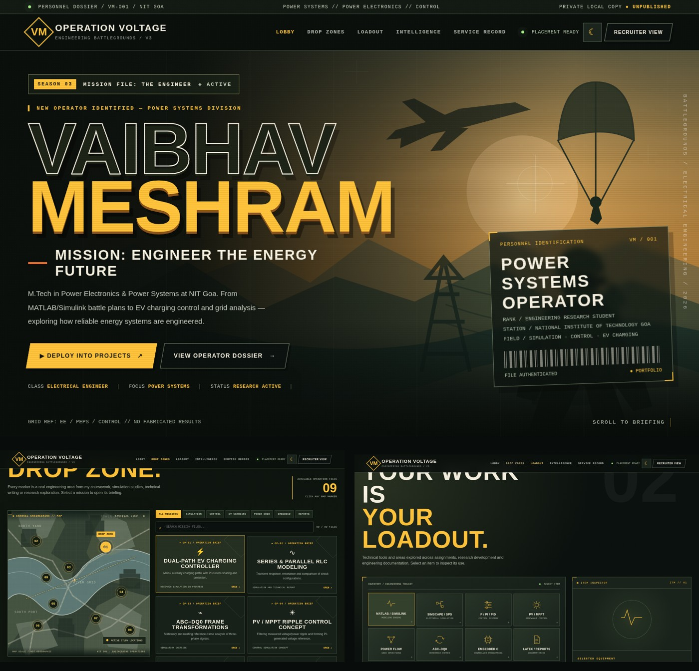

# OPERATION VOLTAGE — PUBG-inspired Engineering Portfolio V3

Editable source-code project for **Vaibhav Meshram**. This is a portfolio themed around tactical game interfaces, not an official PUBG product. It is **not published or publicly hosted**.



## Open and run it in VS Code

1. Extract the ZIP file to a folder on your computer.
2. Open **VS Code** → **File** → **Open Folder** → select `Operation_Voltage_V3_VSCode`.
3. Install **Node.js 18+** if needed.
4. In VS Code choose **Terminal → New Terminal**.
5. Type `npm run dev` (no `npm install` is required).
6. Open **http://127.0.0.1:5173** in your browser.
7. Edit a file and **refresh the browser** to see the change. Stop the server using **Ctrl+C**.

You can also run `npm run check` to validate mission and skills data.

## Where to edit what

| I want to change… | Open this file |
|---|---|
| My name, introduction, navigation and main HTML sections | `index.html` |
| List of projects / mission descriptions / categories | `src/data/projects.js` |
| Skills and Loadout descriptions | `src/data/skills.js` |
| Project filters, modal, map, animations, click interactions | `src/main.js` |
| General colors, fonts, spacing | `src/styles/00-foundation.css` |
| Main menu / header / navigation | `src/styles/01-navigation.css` |
| Hero landing scene / lobby | `src/styles/02-lobby.css` and hero SVG in `index.html` |
| Mission cards and clickable map | `src/styles/03-operations.css` |
| Inventory / engineering loadout appearance | `src/styles/04-loadout.css` |
| Research intelligence, cards and reports | `src/styles/05-intelligence.css` |
| Education and personal introduction | `src/styles/06-service-record.css` |
| Dialogs and drop animation | `src/styles/07-popups.css` |
| Recruiter mode | `src/styles/08-recruiter.css` |
| Mobile and tablet layout | `src/styles/09-responsive.css` |

**Helpful note:** This is a fully editable vanilla HTML, CSS, and JavaScript project, not a React or TypeScript app. It contains a `package.json` and an offline, local Node.js development server so it looks and runs like a normal source project. It does **not** need Replit, a database, paid APIs or an internet connection.

## Project tree

```text
Operation_Voltage_V3_VSCode/
├── .vscode/
│   ├── extensions.json
│   └── settings.json
├── assets/
│   ├── favicon.svg
│   └── portfolio-preview.jpg
├── scripts/
│   ├── check.mjs
│   └── dev-server.mjs
├── src/
│   ├── data/
│   │   ├── projects.js
│   │   └── skills.js
│   ├── styles/
│   │   ├── 00-foundation.css
│   │   ├── 01-navigation.css
│   │   ├── 02-lobby.css
│   │   ├── 03-operations.css
│   │   ├── 04-loadout.css
│   │   ├── 05-intelligence.css
│   │   ├── 06-service-record.css
│   │   ├── 07-popups.css
│   │   ├── 08-recruiter.css
│   │   ├── 09-responsive.css
│   │   └── index.css
│   └── main.js
├── .gitignore
├── index.html
├── jsconfig.json
├── package.json
└── README.md
```

## Privacy

This project has **not been deployed**. The bundled development server listens only on `127.0.0.1` so it is accessible on **your computer only**. Using VS Code, editing it, or running `npm run dev` does not publish your portfolio. Hosting it online would require a separate deployment and your explicit approval.

## Things deliberately not included

No invented numerical performance claims, undocumented employers, fabricated technical results, personal contact addresses, official PUBG assets, or links to unverified research implementations.
